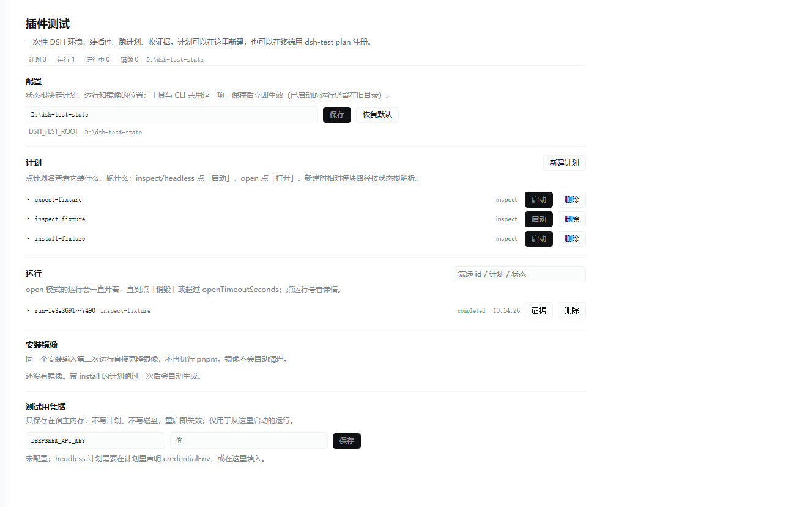

# DSH Plugin Test Controller

> **Public read-only snapshot of v1.11.4.** Development continues in a private upstream repository; this copy is not updated.

[中文](README.md) · English

[](https://github.com/Asern-l/dsh-plugin-test-controller-public/actions/workflows/ci.yml)

Disposable, evidence-producing test runs for [DeepSeek Harness](https://github.com/deepseek-ai/deepseek-harness) plugins.

Every run gets a blank DSH: a fresh `DSH_HOME`, a fresh profile, the packages you asked for, and nothing else. When it ends, the evidence stays and the environment is deleted.

```text
plan ──▶ blank DSH (installed plugins) ──▶ evidence/ ──▶ sandbox deleted
```



## Why

Testing a DSH plugin by hand tells you very little: your own profile, sessions, caches and credentials are in the room. This controller builds the room from scratch for every run, records what happened, and throws the room away.

- **Blank board** — no host profile, no history, no memory files, no credentials beyond what the plan names.
- **Install real packages** — `file:` directories or `npm:name@exact.version`; installed into the disposable profile, never into yours.
- **Evidence or it didn't happen** — `environment.json`, `install.log`, `stdout/stderr`, exported workspace files, all in one directory.
- **Runs that outlive the caller** — a detached worker finishes cleanup even if the host dies; `recover` handles the crashed case.
- **Interactive mode** — park a whole DSH, chat in it, destroy it when you're done.
- **Windows and Linux** — Job Objects on Windows, process groups on POSIX; the same tests run in CI on both.

## Quick start

```bash
npm ci --ignore-scripts

node bin/dsh-test.mjs --root .state doctor
node bin/dsh-test.mjs --root .state plan examples/install-fixture.json
node bin/dsh-test.mjs --root .state run install-fixture
```

`inspect` imports the plugin and dumps its config schema — no model call, no API key. A `completed` run with `cleanup: succeeded` means the import check passed and the temporary tree is gone.

Then a real model turn:

```bash
export DEEPSEEK_API_KEY=...        # never in the plan file
node bin/dsh-test.mjs --root .state plan examples/headless.json
node bin/dsh-test.mjs --root .state run headless-fixture
```

## Plans

A plan is a JSON file the *operator* registers. Agent tools can only start plans by name — they cannot pass code, paths, environment variables or delete targets.

```json
{
  "name": "pipeline-e2e",
  "mode": "headless",
  "prompt": "Call my_tool, check the return value and write report.json.",
  "install": [
    { "source": "file:../packages/model-cache" },
    { "source": "npm:dsh-plugin-verdict@0.3.1" }
  ],
  "plugins": [{ "module": "../my-plugin/dist/index.mjs", "config": {} }],
  "credentialEnv": ["DEEPSEEK_API_KEY"],
  "evidence": ["report.json"],
  "timeoutSeconds": 300
}
```

| mode | what it does |
|---|---|
| `inspect` | imports the plugin, dumps the config schema, runs no model |
| `headless` | one prompt, one session, real model, exit code checked |
| `open` | a parked DSH with a web UI; you chat there, then destroy it |

`install` accepts only `file:<path>` and `npm:<name>@<exact version>`; ranges, `latest`, `git:` and `http:` are rejected because the same plan must install the same code.

### Install images

`installMode: "cached"` (the default) snapshots the prepared profile after the first run and clones it with hard links for the next one — no pnpm on repeat runs (`installMode: "fresh"` forces a reinstall).

The image key covers the DSH version, the install sources and the content hash of every `file:` source, so editing the plugin invalidates the image automatically. Internal links are rewritten to the image's own paths, which keeps the image valid after the sandbox is deleted. `environment.json` records `cached`, `imageKey` and — when a snapshot fails — `imageError`. `dsh-test images` lists stored images; they are never cleaned up automatically.

Measured on the bundled fixture: install drops from ~2 s to 11 ms on the second run.

## Assertions

By default a run only checks the process layer. `expect` turns "it finished" into "it passed": after evidence collection every assertion is evaluated, and one failure marks the run `failed`.

```json
{
  "expect": [
    { "file": "environment.json", "path": "plan", "equals": "expect-fixture" },
    { "file": "stdout.log", "contains": "x-cordis" },
    { "file": "files/report.json", "path": "verdict", "equals": "supported" }
  ]
}
```

- `file` is relative to the evidence directory (`stdout.log`, `install.log`, `environment.json`, `files/<exported>`);
- pick one of `equals` (deep JSON equality, optional `path` with dot notation and numeric indexes), `contains` (text) or `matches` (regular expression);
- results land in `status.check.assertions` with `expected`/`actual` on failure;
- assertions run before `result.json` is written, so don't assert on `result.json` itself.

A failed assertion never interrupts collection or cleanup: the evidence stays complete.


## Agent tools and UI

Install from a checkout (public read-only snapshot: [dsh-plugin-test-controller-public](https://github.com/Asern-l/dsh-plugin-test-controller-public)):

```bash
git clone https://github.com/Asern-l/dsh-plugin-test-controller-public.git <checkout>
cd <checkout>
npm ci --ignore-scripts
node <checkout>/node_modules/@deepseek-ai/dsh/lib/bin.js plugin --profile desktop add <checkout>
```

Restart DSH afterwards. The plugin adds seven tools plus an interactive panel:

| tool | purpose |
|---|---|
| `plugin_test_plans` | list operator-approved plans |
| `plugin_test_start` | start a run, return its id |
| `plugin_test_status` | state, checks, cleanup |
| `plugin_test_cancel` | request cancellation |
| `plugin_test_export` | evidence directory and result |
| `plugin_test_open` | park an interactive DSH run, return its URL |
| `plugin_test_destroy` | destroy a parked run, collect evidence, delete the sandbox |

The web client contributes a **sidebar panel**: plans, runs, evidence and a memory-only test credential, without going through a chat.

Clicking a plan expands a read-only summary: mode, the equivalent DSH command, plugin entries with their config, install sources, `credentialEnv`, evidence list, timeouts and assertions. Plans are created and deleted from the panel, described below.

Clicking a run expands its details: state and duration, errors, individual assertions, install origin (image or fresh), package versions, evidence files with sizes and the tails of `install.log`, `stderr` and `stdout`. The header shows plan/run/live/image counters and a run filter.

The **configuration** block edits the state root in place: saving takes effect immediately, the agent tools and the CLI read the same setting (`<DSH_HOME>/plugin-test-controller/ui-settings.json`), and "reset" clears the override. Runs already started keep their old directory.

**Plans can be created and deleted from the panel**: "new plan" takes JSON, validates it with the same `validatePlan` the CLI uses (relative module paths resolve against the state root) and writes `plans/<name>.json`; deletion asks for confirmation. Settled runs can be deleted together with their evidence; live runs must be cancelled or destroyed first.

## State and cleanup

```text
$DSH_HOME/plugin-test-controller/
├── plans/<name>.json
└── runs/<id>/
    ├── owner.json plan.json status.json
    ├── sandbox/            # deleted at cleanup
    └── evidence/
        ├── environment.json install.log
        ├── stdout.log stderr.log result.json
        └── files/          # explicitly exported workspace files
```

Resolution order: plugin `config.root` → `DSH_TEST_ROOT` → `$DSH_HOME/plugin-test-controller`. State travels with the DSH home it belongs to.

Cancellation writes a `cancel` file; the worker polls it, kills the process tree and removes the sandbox. If the worker itself dies, `dsh-test recover <id>` verifies the recorded PIDs are gone before touching anything.

## Scope

The isolation is **directories and process lifetime, not a container**. Plugins are trusted code and can reach the host filesystem, network and devices. Results produced outside the sandbox (a real device, an external database) need their own restore path. See [docs/isolation.md](docs/isolation.md).

## Development

```bash
npm run check
npm test
npm run test:integration
DSH_TEST_INSTALL=1 npm run test:integration   # also exercises the install phase
npm run pack:check
```

Requires Node 24+, DSH `0.2.1-rc.5`, and `pnpm` on the host when a plan installs packages.

## License

MIT
