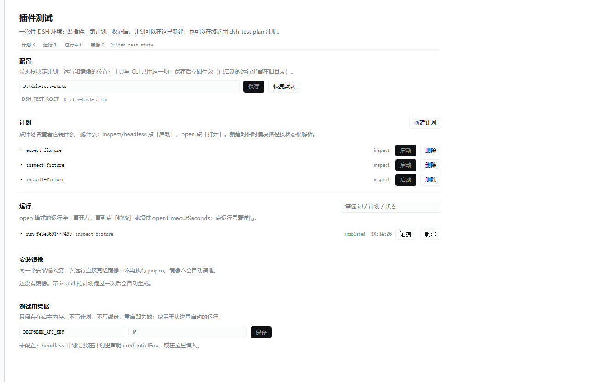

# DSH Plugin Test Controller

> **本仓库是 v1.11.4 的公开只读快照。** 后续开发只在私有上游仓库进行，此副本不再更新。

[English](README.en.md) · 中文

[](https://github.com/Asern-l/dsh-plugin-test-controller-public/actions/workflows/ci.yml)

为 DeepSeek Harness（DSH）插件提供可丢弃的测试环境：每轮创建独立会话与数据目录，运行指定插件，导出证据，然后清理临时环境。

> 一句话：**每次测试都从一块白板开始，跑完只留下证据。**
> 可以在白板上装插件（`file:` / `npm:name@exact`），可以跑一次性计划，也可以开一个交互式 DSH 自己聊，聊完销毁。



支持 Windows 和 Linux。首版固定适配 **DSH `0.2.1-rc.5`、Node.js 24+**，避免上游接口变化导致测试结论漂移。插件、运行器和命令行使用同一套实现。

**桌面版用户：请使用 v1.0.1 或更高版本，并在更新后重启桌面 DSH。** v1.0.0 在 Electron 中启动 worker 时遗漏 Node 模式，会出现 `Worker exited before readiness (0)`。v1.0.1 在 worker 启动和实际 DSH 执行两处显式设置 Electron Node 模式；普通 Node CLI 仍使用 Node 本身。

## 架构

```text
管理用 DSH → 测试控制插件 → 独立后台运行器
                              ├─ 全新 DSH_HOME / DSH_AGENTS_HOME
                              ├─ 独立 HOME / 用户配置 / 缓存 / 临时目录
                              ├─ 临时工作区 + 待测插件
                              ├─ 有限时长、有限输出、取消控制
                              └─ 导出证据 → 结束进程树 → 删除临时目录
```

运行器不依赖管理用 DSH 的对话历史。控制插件卸载时会请求取消本插件启动的任务；独立运行器继续完成清理。管理进程突然消失时，已启动的任务仍受超时约束。

**这里隔离的是约定的数据目录和进程生命周期，不是容器或虚拟机。** DSH Host 插件是受信任代码，可以访问宿主机文件、网络和远程设备。在外部数据库、代码目录或目标真机上产生的状态，需要相应插件单独恢复。详见 [隔离边界](docs/isolation.md)。

## 安装与无密钥演示

```powershell
git clone https://github.com/Asern-l/dsh-plugin-test-controller-public.git
cd dsh-plugin-test-controller-public
npm ci --ignore-scripts

node bin/dsh-test.mjs --root .state doctor
node bin/dsh-test.mjs --root .state plan examples/inspect.json
node bin/dsh-test.mjs --root .state run inspect-fixture
```

`inspect` 调用真正的 DSH CLI 导入待测模块、检查配置 schema，不调用模型，**不会执行插件的 `apply` 或证明插件功能正确**。示例退出码为 0、`state: completed` 和 `cleanup: succeeded` 表示导入检查完成且本轮临时目录已清理。

测试报告位于 `.state/runs/<run-id>/evidence/`。再次运行会产生新的数据目录；上一轮证据不会自动输入下一轮。

## 完整 Agent 测试

```powershell
$env:DEEPSEEK_API_KEY = '<你的测试 API key>'
node bin/dsh-test.mjs --root .state plan examples/headless.json
node bin/dsh-test.mjs --root .state run headless-fixture
```

这一步调用真实模型，可能消耗额度。不要把密钥写入 JSON、插件配置或 Git 仓库。CLI 的 `run` 等待任务结束；Ctrl+C 请求中止并等待清理。

非默认模型网关可通过计划的 `credentialEnv` 显式允许 `DEEPSEEK_BASE_URL`。DSH 此版本采用 **Messages 协议**；仅提供 OpenAI Chat Completions 的网关不兼容。

## 在管理用 DSH 中安装控制插件

从仓库安装（公开只读快照：[dsh-plugin-test-controller-public](https://github.com/Asern-l/dsh-plugin-test-controller-public)）：

```powershell
git clone https://github.com/Asern-l/dsh-plugin-test-controller-public.git <checkout>
cd <checkout>
npm ci --ignore-scripts

node <checkout>/node_modules/@deepseek-ai/dsh/lib/bin.js plugin --profile desktop add <checkout>
```

安装后重启管理用 DSH。bundle 的 `cordis.patch.yml` 会挂载本插件。也可以直接使用临时 overlay：

```powershell
$env:DSH_TEST_ROOT = 'D:\dsh-test-state'
node <checkout>/node_modules/@deepseek-ai/dsh/lib/bin.js web --patch <checkout>/cordis.patch.yml
```

先在**同一个状态根目录**注册计划：

```powershell
node bin/dsh-test.mjs --root D:\dsh-test-state plan examples/inspect.json
```

然后对管理用 DSH 说：

> 使用 plugin_test_plans 查看测试计划，启动 inspect-fixture，查询状态直到结束，再导出结果并检查 cleanup。

插件暴露 7 个工具，返回规范 JSON 值：

| 工具 | 参数 | 用途 |
|---|---|---|
| `plugin_test_plans` | 无 | 查看操作者预先注册的计划 |
| `plugin_test_start` | `plan` | 后台启动一轮，返回任务 ID |
| `plugin_test_status` | `id` | 查询执行与清理状态 |
| `plugin_test_cancel` | `id` | 请求中止；之后继续查询状态 |
| `plugin_test_export` | `id` | 获取已结束任务的证据目录与结论 |
| `plugin_test_open` | `plan` | 起一个可交互的 DSH，返回它的地址 |
| `plugin_test_destroy` | `id` | 关掉交互运行，取证据并删除沙箱 |

计划注册既可以用 CLI，也可以在面板里新建；故障恢复保留在 CLI 中。Agent 工具不接收任意命令、插件路径、环境变量或删除路径。使用直接 overlay 时，可以给插件的 `config.root` 配置独立状态目录；也可以使用 `DSH_TEST_ROOT`。

状态根的解析顺序是 `config.root` → `DSH_TEST_ROOT` → `%DSH_HOME%\plugin-test-controller`（`DSH_HOME` 未设置时退回 `~/.dsh`）。默认值跟着 `DSH_HOME` 走：备份 `.dsh` 就带走了全部计划、运行和证据，换环境也不会读到另一份旧数据。

## 界面（v1.1.0 起，v1.4.0 改为侧边栏）

插件是完整的 DSH 客户端插件：**侧边栏「插件测试」**是独立的一整页操作台，和「插件」「自动化任务」并列，点开就能用，不必经过主聊天。页面里能看状态根、注册的计划和最近运行，直接启动、取消、打开证据目录，每 3 秒刷新。

点计划名可以展开**只读详情**：它的模式、等价 DSH 命令、插件入口与 config、安装来源（`file:`/`npm:`）、`credentialEnv`、证据清单、超时和断言列表。新建与删除计划见本节末尾。

点运行号可以展开**运行详情**：状态与耗时、错误与清理错误、逐条断言、安装来源（镜像/本次）、包版本、证据文件与大小、`install.log` / `stderr` / `stdout` 尾部。顶部有概览（计划/运行/进行中/镜像）和运行筛选框。

**配置区可以直接改状态根**：保存后立即生效，Agent 工具和 CLI 读同一个设置（`<DSH_HOME>/plugin-test-controller/ui-settings.json`），「恢复默认」清掉覆盖；已启动的运行仍留在旧目录。

**计划可以在面板里新建和删除**：「新建计划」粘贴 JSON，用和 CLI 完全相同的 `validatePlan` 校验后写入 `plans/<name>.json`（相对模块路径按状态根解析）；删除有确认提示。已结束的运行也能删（连带证据目录），仍在运行的必须先取消/销毁。

同一页还能填**测试用凭据**（例如 `DEEPSEEK_API_KEY`）：

- 只存在宿主内存里，不写计划、不写磁盘、不进 argv，重启即失效；
- 只对从这一页启动的运行生效，CLI 启动的仍走计划的 `credentialEnv`；
- 值的名字会并入该轮记录的 `credentialEnv`，所以证据脱敏和 `environment.json` 的审计都覆盖它；接口永远不回显值。

其它实现要点：

- 浏览器侧入口是 `src/client.js`，通过 `exports["./client"]` 和 `package.json` 的 `dsh.client` 声明注册，挂到 `sidebar.panellist`（入口）和 `main`（整页）两个槽位。
- 宿主侧入口是 `src/panel.mjs`，只应答 `/plugin-test/state|start|cancel|status|export|credentials`；注册在 DSH 自己的 web 服务上，不额外开端口，并拒绝跨源请求。
- 没有 web 服务的环境（例如 `dsh-test` 的一次性 DSH）只会挂载工具插件，`panel.mjs` 因 `inject: ['webServer']` 不会激活，CLI 与工具行为不变。
- 客户端 bundle 是手写的 `window.__ModuleLoader__.load({ id, factory })` 格式，不需要构建步骤；只用 React 和行内样式。

改动后需要重启桌面 DSH（客户端 bundle 在启动时进入 `__DSH_BOOT__`）。

## 交互模式（open）

计划里把 `mode` 写成 `open`，得到的是一个**一直开着的一次性 DSH**：你自己在它的界面里聊天，不想用了再销毁。

```json
{
  "name": "open-fixture",
  "mode": "open",
  "install": [{ "source": "file:./fixture-bundle" }],
  "openTimeoutSeconds": 600
}
```

```powershell
dsh-test --root .state plan examples/open-fixture.json
dsh-test --root .state open open-fixture     # 打印 id + 带 token 的 URL
dsh-test --root .state destroy <run-id>      # 结束：杀进程树、收证据、删 sandbox
```

- 面板里 `open` 模式的计划显示「打开」，运行中的那一行显示「打开」「销毁」。
- URL 里带一次性 token，等同于进入那个 DSH 的钥匙，别外传。
- 没有 `destroy` 也会在 `openTimeoutSeconds`（默认 7200 秒）后自动结束，状态记为 `timed_out`。
- 它有自己的 `DSH_HOME`，不共享宿主的历史、凭据和插件；聊天同样消耗模型额度。
- 证据里保留那个 DSH 的 stdout/stderr；**会话记录不导出**，销毁时随 sandbox 一起删除。

## 测试你自己的插件

创建 JSON 计划：

```json
{
  "name": "my-plugin-test",
  "mode": "headless",
  "prompt": "调用 my_tool，检查它的返回值，并把结果写入 result.json。",
  "plugins": [{ "module": "../my-plugin/src/index.mjs", "config": {} }],
  "credentialEnv": ["DEEPSEEK_API_KEY"],
  "evidence": ["result.json"],
  "timeoutSeconds": 120,
  "maxOutputBytes": 8388608
}
```

相对模块路径以原始计划文件的位置为基准。模块必须已经构建为 Node 可加载的 JS/ESM，依赖也需要提前安装。包名从测试运行器的 DSH 安装中解析；外部插件推荐使用构建入口的绝对路径或相对路径。

### 在一次性环境里安装插件

`plugins` 是"从路径加载一个模块"；如果被测对象是一个带 `cordis.patch.yml` 的完整 bundle，或者需要依赖，就用 `install`：

```json
{
  "name": "install-fixture",
  "mode": "inspect",
  "install": [{ "source": "file:./fixture-bundle" }],
  "installTimeoutSeconds": 300
}
```

- 来源只有两种：`file:<绝对或相对路径>` 和 `npm:<包名>@<精确版本>`。范围、`latest`、`git:`、`http:` 一律拒绝，否则同一个计划会装出不同的代码。
- 装进的是**一次性 profile**（`sandbox/dsh-home/profiles/...`），不会碰宿主 profile；`file:` 是复制而不是链接，所以装完的代码和宿主改动脱钩。
- 安装阶段独立超时（`installTimeoutSeconds`，默认 300 秒），失败会写 `evidence/install.log` 并让本轮 `failed`，不会进入运行阶段。
- `environment.json` 记录解析到的包名、版本、`pnpm-lock.yaml` 哈希和耗时，重启后再跑也能证明装的是哪一份。
- 安装强制 `--ignore-scripts`；复用宿主的 pnpm store 和 registry 配置（内容寻址缓存，不影响测试结果）。
- 需要宿主机上能找到 `pnpm`（DSH 的插件管理器也用同一个）。

安装阶段和 `plugins` 可以同时用：`install` 把 bundle 装进 profile（它自己的 patch 会挂载），`plugins` 再从任意路径额外插入模块。

### 镜像：装一次，之后克隆

默认 `installMode: "cached"`：第一次跑完之后，把准备好的 profile 存成镜像（`<状态根>/images/<key>/`），下次同样的安装输入**不再跑 pnpm**，直接从镜像硬链接克隆到 sandbox。

```json
{ "install": [{ "source": "file:./fixture-bundle" }], "installMode": "cached" }
```

- key = DSH 版本 + 安装源 + 每个 `file:` 目录的内容哈希。源码、版本或 DSH 变了，key 就变，自动重建；
- 克隆用硬链接（同卷毫秒级）；跨卷或没有权限时退回真实复制；
- 镜像里指向内部的链接会**重写到镜像自己的路径**，所以原始 sandbox 删掉之后镜像依然可用；
- `environment.json` 的 `install` 会记录 `cached` / `imageKey`，失败时还有 `imageError`；
- `installMode: "fresh"` 强制重新安装（用来验证安装链路本身）；
- `dsh-test images` 列出已有镜像。镜像不会自动清理，需要时手动删 `<状态根>/images/<key>`。

实测：同一计划第二次运行，安装阶段从约 2 秒降到 **11 毫秒**。

### 断言：让"完成"变成"通过"

默认只检查进程层（退出码、最终输出）。加上 `expect`，跑完会读证据、逐条比对，任何一条不满足就把这一轮判为 `failed`：

```json
{
  "name": "expect-fixture",
  "mode": "inspect",
  "plugins": [{ "module": "./fixture-plugin.mjs" }],
  "expect": [
    { "file": "environment.json", "path": "plan", "equals": "expect-fixture" },
    { "file": "environment.json", "path": "credentialNames", "equals": [] },
    { "file": "stdout.log", "contains": "x-cordis" },
    { "file": "result.json", "matches": "\"state\": \"completed\"" }
  ]
}
```

- `file` 是证据目录内的相对路径：`stdout.log`、`stderr.log`、`environment.json`、`files.json`、`install.log`、`files/<导出文件>`；
- 三种匹配方式选一种：`equals`（JSON 深度相等，可配 `path` 取嵌套字段，数组用数字下标）、`contains`（文本包含）、`matches`（正则）；
- 结果写进 `status.check.assertions`（每条含 `ok`、失败时的 `expected`/`actual` 或 `error`）；
- 断言在 `result.json` 写入**之前**执行，所以不要断言 `result.json` 本身——它记录的就是断言结果。

单条断言失败不会中断收集和清理，只会让结论变成 `failed`，证据完整保留。

`config` 由操作者审查后保存，不能包含密钥。运行器不会从日常使用的 DSH 复制 profile、历史会话、记忆文件或凭据。

支持字段及数据约定见 [接口说明](docs/contracts.md)。

## 状态、证据和清理

```text
queued → preparing → running → collecting → cleaning
                                              ├─ completed
                                              ├─ failed
                                              ├─ cancelled
                                              ├─ timed_out
                                              └─ output_limit
```

`state`、`cleanup`、`verdict` 相互独立：

- `completed`：inspect 的配置导入检查成功；或 headless 进程退出码为 0，存在最终输出，且终止原因是 completed。
- `cleanup: succeeded`：受管理的临时目录已删除。它不代表远程设备或宿主机其他目录已恢复。
- `verdict: not_evaluated`：本控制器不判定微架构漏洞是否存在；需要业务判定插件和正负对照证据。

每轮保留：

```text
runs/<id>/
├─ owner.json / plan.json / status.json  # 管理记录，后续测试不会自动读取
└─ evidence/
   ├─ environment.json                 # 运行时版本、插件入口哈希、计划哈希
   ├─ stdout.log / stderr.log
   ├─ result.json
   ├─ files.json                       # 显式导出文件的清单、哈希或错误
   └─ files/                           # 计划 evidence 指定的工作区文件
```

不会整体导出 DSH home 或会话存储。已显式注入的环境变量值会在日志和证据中做精确匹配替换；这不是任意敏感信息检测器。不要将未审查的运行归档直接上传 GitHub。

CLI 还支持：

```powershell
node bin/dsh-test.mjs --root .state start inspect-fixture
node bin/dsh-test.mjs --root .state list
node bin/dsh-test.mjs --root .state status <run-id>
node bin/dsh-test.mjs --root .state cancel <run-id>
node bin/dsh-test.mjs --root .state export <run-id>
node bin/dsh-test.mjs --root .state recover <run-id>
```

`recover` 用于运行器崩溃或机器重启后的本地目录恢复：先检查记录中的运行器和子进程 PID 已不存在，再验证目录所有权并删除 sandbox。如果 PID 仍在运行，会拒绝操作，要求先核对进程，避免误杀复用的 PID。不会自动恢复远程机器。

## 开发与验证

```powershell
npm run check
npm test
npm run test:integration
npm run pack:check
```

集成测试使用真正的 DSH CLI 和 Cordis 工具注册器。headless 集成测试使用本地确定性 Messages 服务，验证模型工具调用、证据采集与清理，不需要真实 API 密钥，不调用公网模型。它验证调用链，无法替代真实模型和目标硬件上的验收。

GitHub Actions 在 Windows / Ubuntu 上执行同一组检查。

## 后续业务插件

设备探测、适用性分析、用例生成、真机执行和结果判定可以分别实现为插件，并用本控制器测试。它们尚未包含在本仓库中。真机执行插件应自行提供环境记录、设备占用及恢复能力。

参考：[DSH 官方仓库](https://github.com/deepseek-ai/deepseek-harness)、[插件工具接口](https://github.com/deepseek-ai/deepseek-harness/blob/master/docs/cookbook/adding-a-tool.md)。兼容基线是 DSH `0.2.1-rc.5`；上游 master 文档可能已包含后续版本接口。
